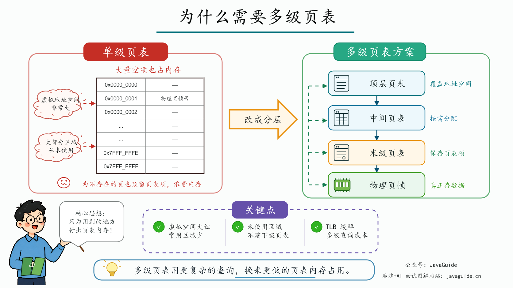
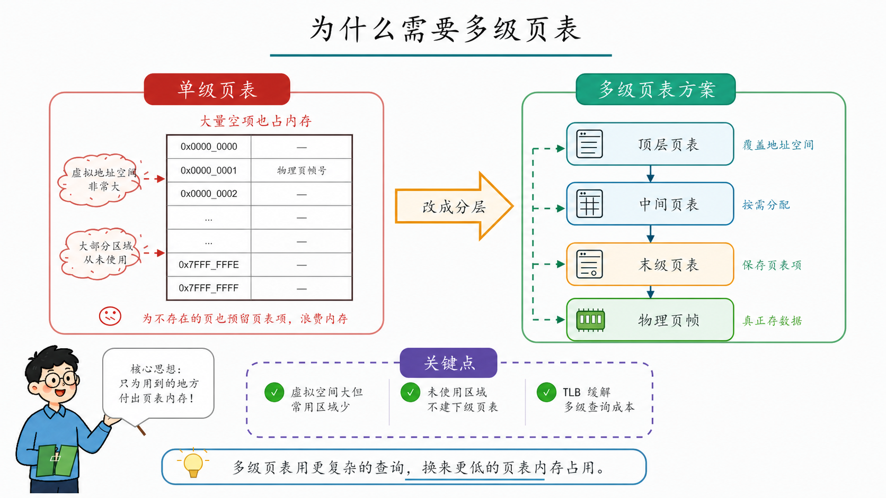
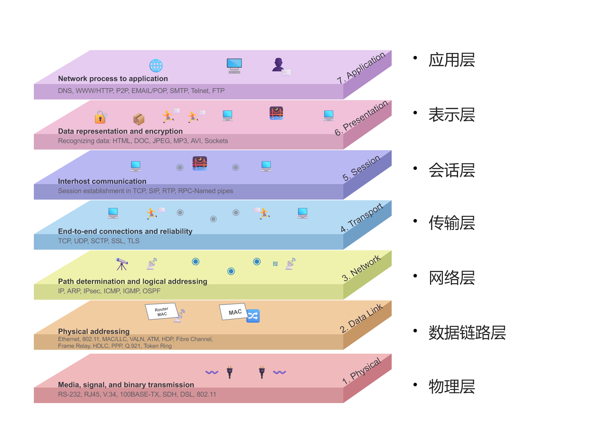
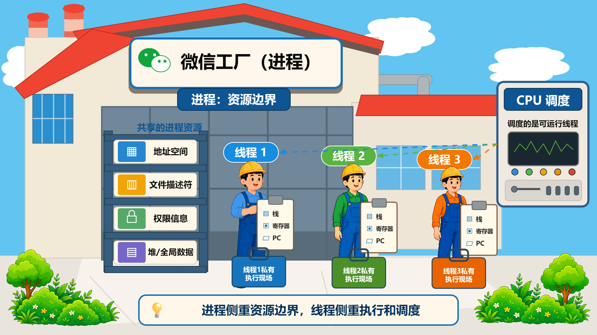
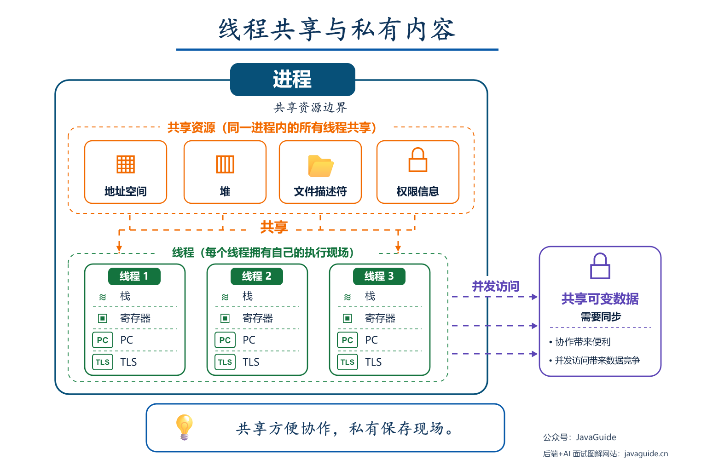
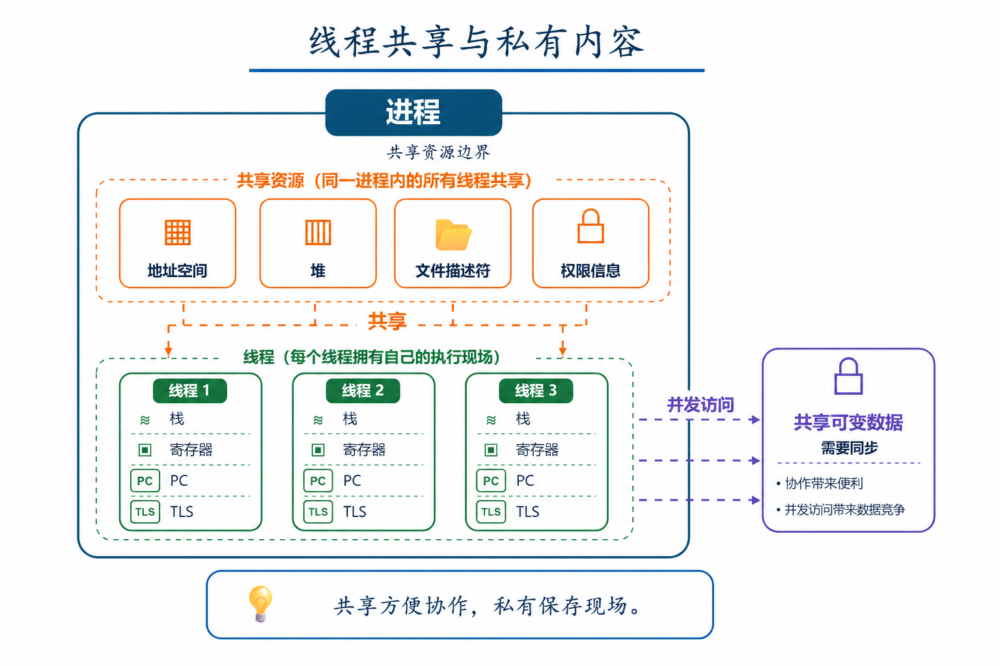

# picture2ppt examples

These images are final rendered slides from successful picture-to-PowerPoint reconstructions. Each deck was rebuilt as independently editable text, shapes, connectors, tables, and/or atomic generated stickers; the source screenshot was not embedded as a composite slide layer.

The two paired examples below also show a targeted image edit: the original render is preserved on the left, and the `imagegen` cleanup is shown on the right with only the footer promotion removed. This makes the workflow's “rebuild, inspect, then refine an asset” loop visible.

## Multi-level page tables

| Original render | Cleaned render |
| --- | --- |
|  |  |

## OSI seven-layer model

## Process and resource boundaries

## Thread shared and private content

| Original render | Cleaned render |
| --- | --- |
|  |  |
